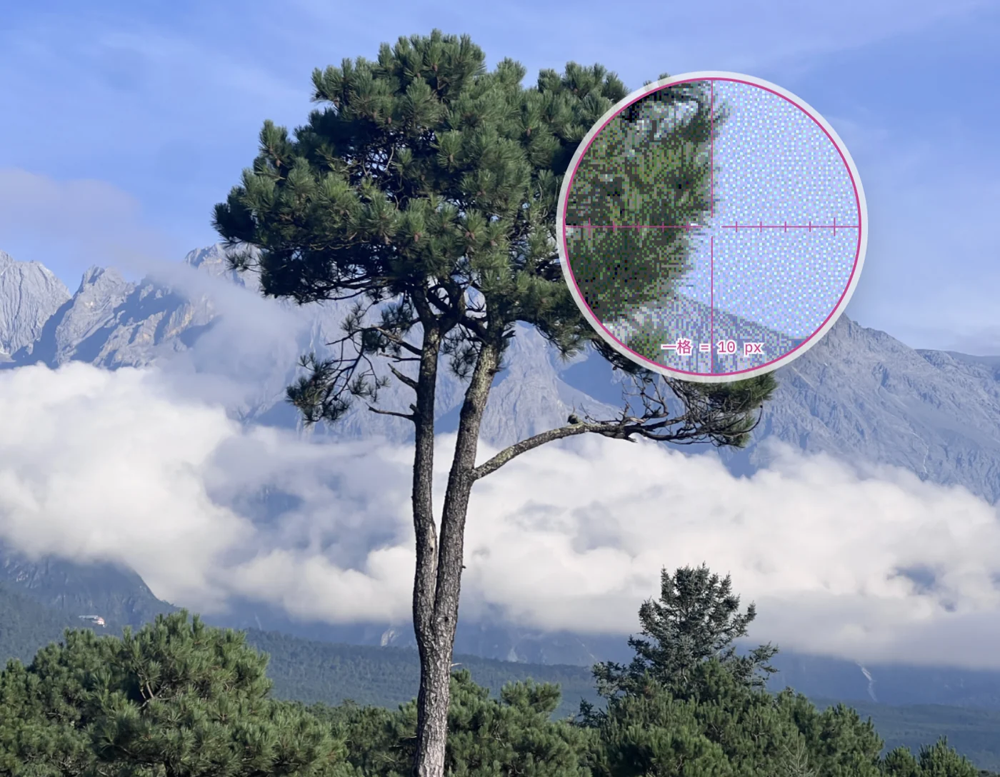
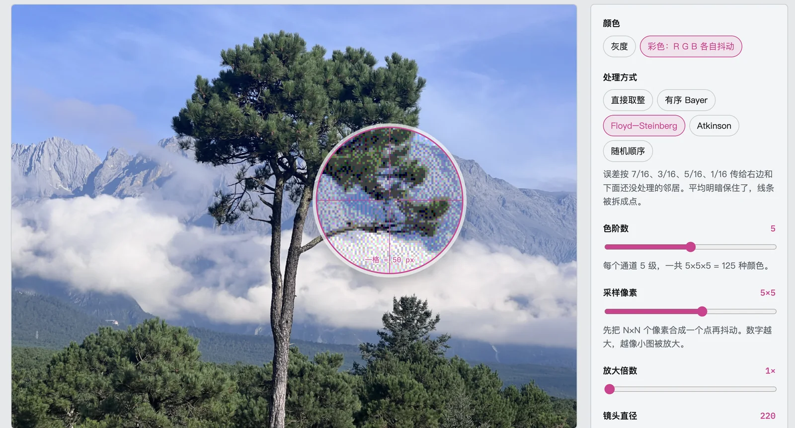
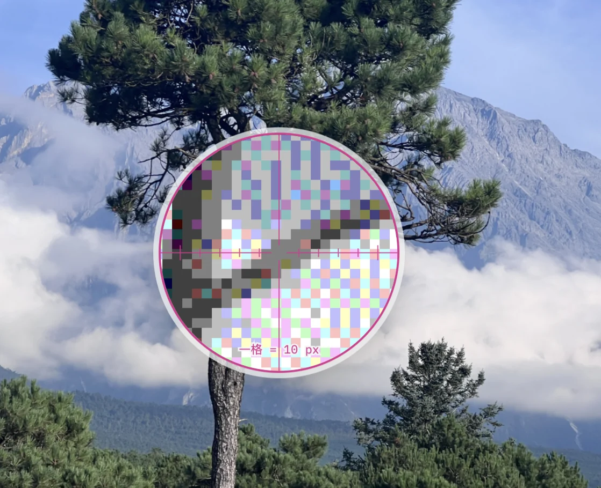

# Dither Loupe

A browser extension in the shape of a magnifying glass. Whatever sits under the loupe is shown dithered, live, as you move it across the page.

## What you can change

- **Algorithm**: plain rounding, ordered (Bayer), Floyd–Steinberg, Atkinson, or random order, each with a short explanation of where the rounding error goes.
- **Colour**: greyscale, or each RGB channel dithered separately.
- **Levels**: how many steps per channel, and so how many colours are left.
- **Sampling**: how many pixels are merged into one dot before dithering.
- **Magnification and lens size.**

## Why

Dithering is one of the oldest tricks for making images fit limited screens and bandwidth. The loupe started as a toy, then became a way to discuss the *poor image*: the compressed, degraded copies that most images become as they circulate online. Looking through the loupe turns that invisible loss into something you can see and play with.

## Status

Prototype.
