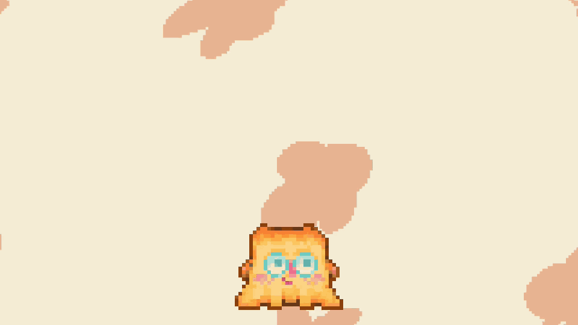
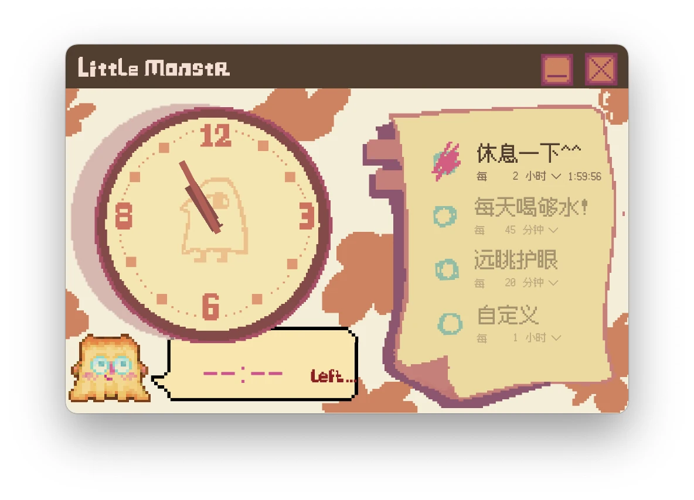

# Little Monster

A pixel-art desktop pet: a little monster that lives on your screen and doubles as a reminder and an alarm clock, to bring some colour to routine desk work.

It keeps a list of recurring reminders, such as taking a break, drinking water or resting your eyes, each with its own interval, plus custom ones. A clock and a countdown show how long is left until the next one.

A small vibe-coded project, with art I drew myself.

*Link coming soon.*
