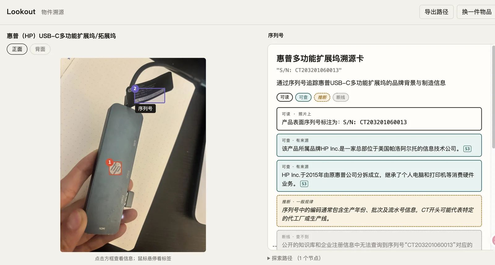
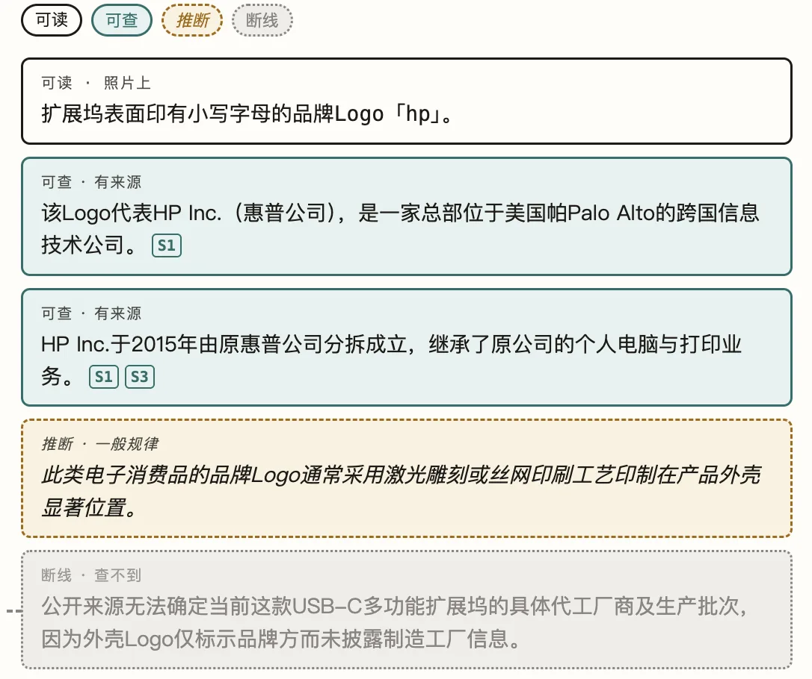
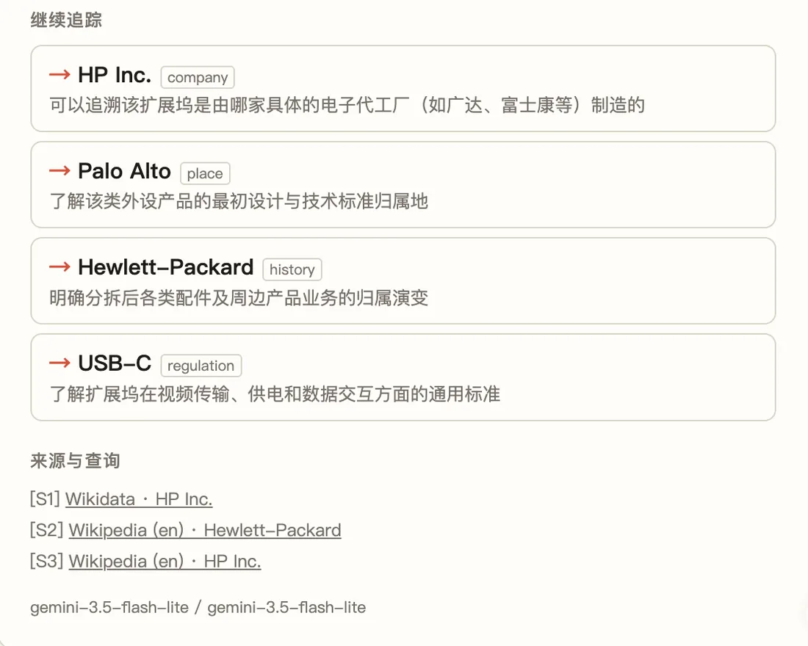

# LookOut

A receipt, a label on a printer, a building site seen from the street: every everyday object carries traces of where it came from, and most of them go unnoticed. Where was this made? Who is this company? What stood on this site before, and where will this sand go next?

LookOut uses multimodal recognition to pick out the information points in a photo. Each point opens a trace card, and every card can be followed further upstream, so tracing becomes a branching exploration rather than a single answer.

## Four layers of certainty

Every statement on a card is labelled by how far it can be trusted:

- **Readable**: what is literally printed on the object in the photo.
- **Checkable**: facts backed by a cited public source.
- **Inferred**: the model's general-knowledge guesses, marked as such.
- **Dead end**: what could not be found, said openly instead of filled in.

## Keep tracing

Each card ends with branches to follow, such as a company, a place, a piece of history or a standard, together with the sources that were consulted. The path you take can be exported.

## Research questions

- **Layered information and trust.** Does showing what is readable, checkable and inferred as separate layers change how much people trust AI output, and does it make them more willing to verify it themselves?
- **Branching versus reporting.** Compared with a complete report delivered all at once, how does adventure-game-style branching affect people's understanding of, and curiosity about, the supply chains behind an object?

## Status

A simple prototype. I am currently working on the credibility of the traced information.
