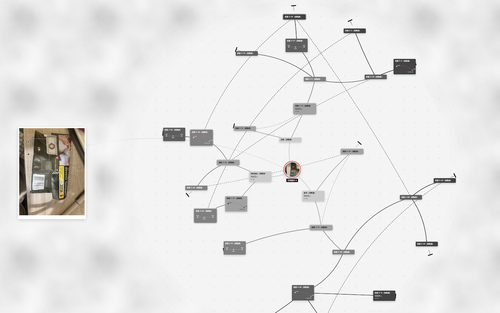

# LookOut: Letting Everyday Objects Tell Their Own Stories through Branching Exploration with Multimodal LLMs

The objects we handle every day are half visible, half hidden. Behind the most unassuming item lies a dense, largely unseen web of histories: what materials make it up, where and by whom it was made, how far it traveled to reach our hands, and where it goes once discarded. If we shifted to the object’s own perspective, how much of the world’s other side would surface in its autobiography? 

Driven by this question, I designed Lookout, an exploratory system for encountering the world from the vantage point of things. Users snap and upload a photo to Lookout, where a multimodal large language model identifies the object alongside its legible surface details, unfolding the invisible stories behind it as a multi-layered branching structure. Every recognizable detail becomes a pathway leading deeper into the unknown. Navigating the interface feels like uncovering a map in a game: clues that withstand deep provenance tracing stretch far across the canvas, while unrecoverable trails terminate abruptly as short dead ends.

## Research questions that I wanna propose...

Building on more-than-human design and thing ethnography, this project gamifies the opaque chains of production, supply, and information transmission—bringing critical inquiry out of the research lab and into everyday life. 

Through this branching provenance architecture, I also investigate non-linear exploration and sensemaking with LLMs: when confronted with AI-generated research, how can mind-map-like visual scaffolding help users retain epistemic agency rather than passively consuming answers? And what design implications does this hold for reimagining human-AI interaction in an era saturated with AI tools?

## This work may offer three anticipated contributions...

(1) an interactive prototype integrating scene recognition, open-source data retrieval, first-person object narrative, and layered evidence; 

(2) a set of design propositions uniting object narrative, visible evidence, and branching disclosure—notably framing "broken trails" (dead ends) as a deliberate, meaningful interface element;

(3) an empirical user study examining how first-person storytelling and evidence visualization shape user curiosity, calibrate trust in AI-generated content, and reframe our everyday relationship with things.

## Status

At the moment, it is still just a simple prototype that can only be tested using a few example images. I am currently working on the credibility of the traced information.

