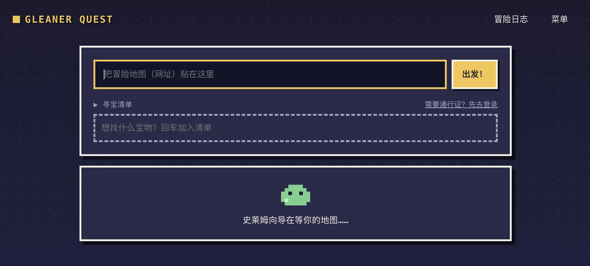
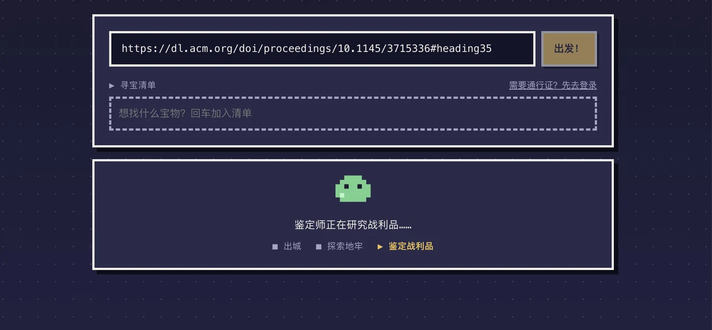
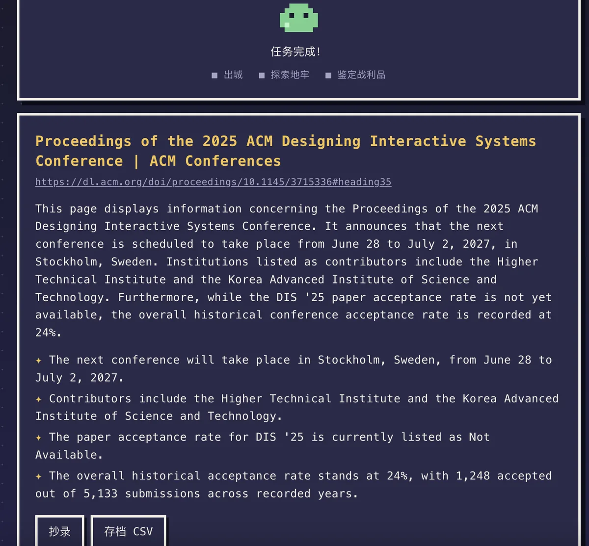

# The Gleaner

A desktop tool for collecting information from the web, built around a crawler but presented as a small adventure game. You hand it a link, it sets off, and it returns with the material organised and summarised by keyword.

## How it works

- **The map and the treasure list.** The link you paste is the adventure map; the keywords you care about go on a treasure list.
- **A visible journey.** A slime guide reports each stage of the run as it happens: leaving town, exploring the dungeon (crawling), and appraising the loot (summarising with a language model).
- **Bring your own model.** The model is connected through an API, and users can swap in a better or different one.
- **Skins.** The whole interface is skinnable. I plan to open-source it so that anyone can design and share their own skin.

## Why

Information gathering tools usually hide their process behind a progress bar. Framing the crawl as an expedition makes an automated process legible and gives users a playful sense of agency over it, and the open skin system invites people to reshape the tool rather than adapt to it.

## Status

A working build exists; not yet ready for release.
