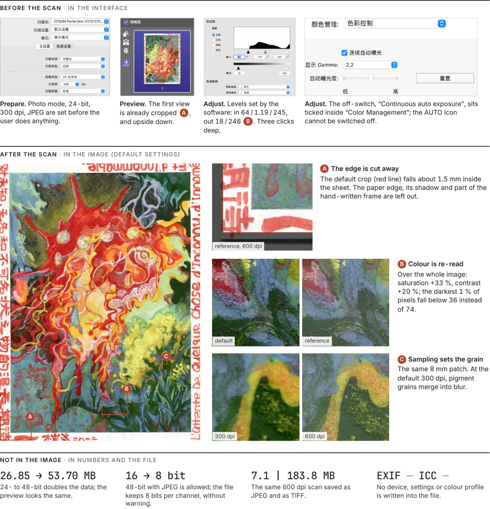
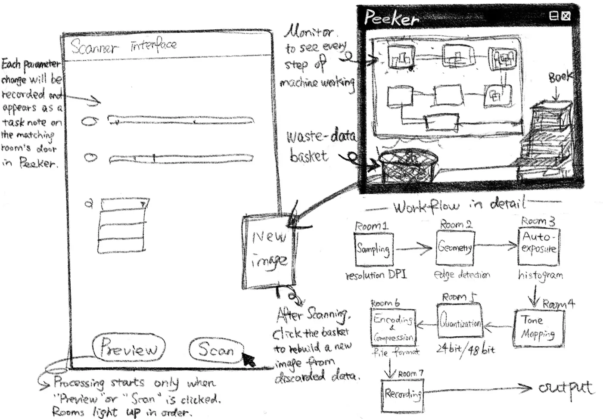
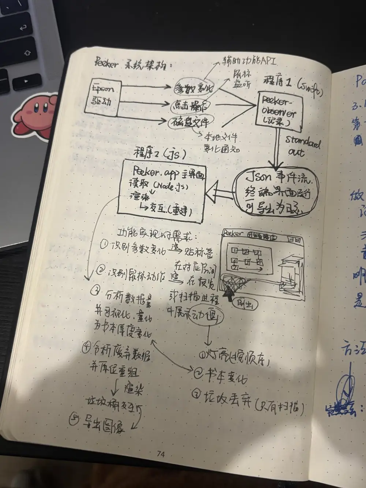
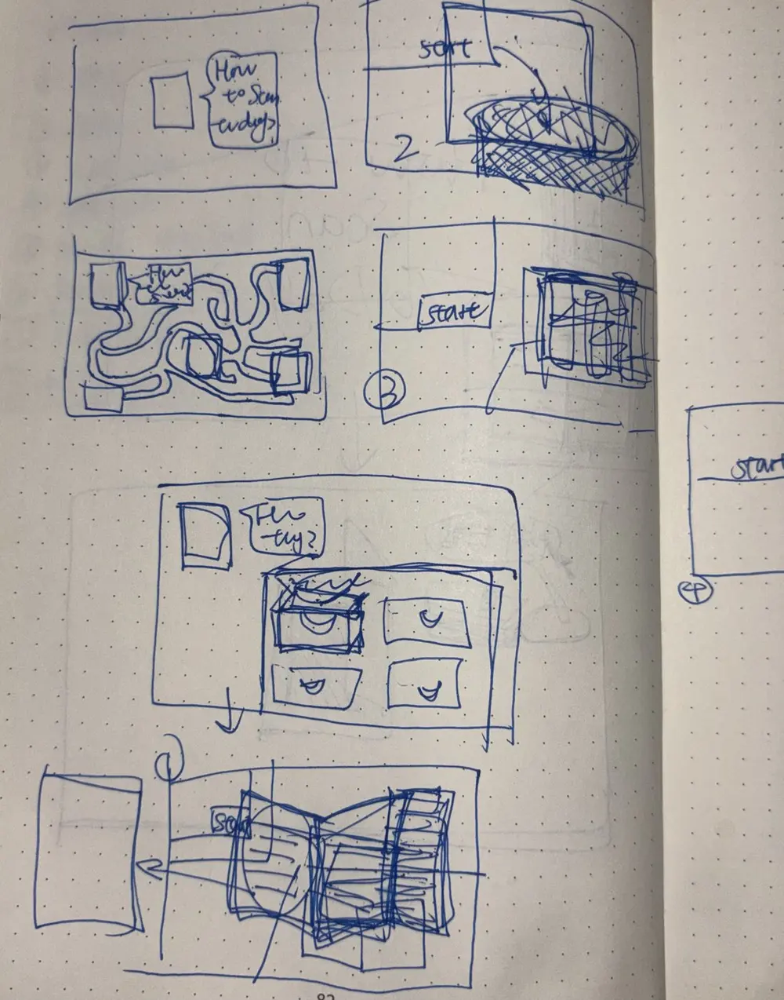

# Peeker

How does a machine come to know a physical image? Peeker is an ongoing research-through-design project on the processing that everyday scanners hide from us, from the first question to the prototype I'm building now.

<section class="step">

Step 1

## Where do digital images come from?

Image digitisation is everywhere, yet we rarely look at it. Faced with a scanner's confusing settings, most people simply press "auto", or take a photo with their phone instead. It is as if digital images were made by magic.

I became curious about how a machine comes to know a physical image, and started learning how scanners work, from the hardware up.

</section>

<section class="step">

Step 2

## Reading around

A literature review: has anyone looked at this question before, and from which angles?

Some of what I read along the way is in my [Reading Notes](../reading/).

</section>

<section class="step">

Step 3

## Scanning slowly

A first-person experiment. While scanning one of my paintings, I deliberately changed the parameters and tried different devices, to see how the machine's involvement leaves traces in the digitisation process.

- **Before the scan**, many choices are already made: photo mode, 24-bit, 300 dpi and JPEG are set before the user does anything, the preview is cropped automatically, and continuous auto exposure is switched on.
- **In the image**, the default settings cut away the edge of the sheet, re-read the colours and set the grain of the pigment.
- **Outside the image**, the file keeps its own decisions: bit depth, file format, and no record of the device or settings that made it.

</section>

<section class="step">

Step 4

## Peeker v1

The first prototype is a companion window that sits next to the scanner interface.

The scanning workflow is drawn as a series of rooms: Sampling, Geometry, Auto-exposure, Tone mapping, Quantisation, Encoding & compression, and Recording. Every parameter change appears as a note on the door of the matching room, and when you press Preview or Scan the rooms light up in order. A book grows as data piles up, and a waste-data basket collects what was discarded, so you can rebuild a new image from it.

### Architecture

Peeker is made of two programs:

- **Observer** (Swift) runs in the background and records three kinds of input: parameter changes through the accessibility API, clicks through a global mouse listener, and changes to local files. It outputs a JSON event stream.
- **Peeker.app** (JavaScript) reads the event stream, renders it, and lets you interact with it.

</section>

<section class="step">

Step 5

## What didn't work

The first trial didn't go as hoped: too much was packed into one long and complex experience. I split the features apart and reorganised them into a design space, so that each idea can be explored on its own.

</section>

<section class="step now">

Step 6 · Now

## Prototyping the design space

I'm now sketching and prototyping different points of the design space.

In the meantime, the Observer is built. The next step is a first test with a real scanner, recording event logs to analyse how people interact with it.

</section>
